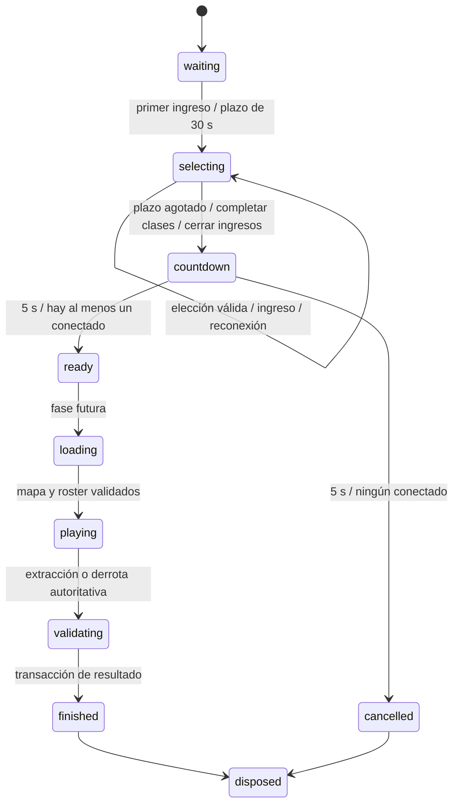

# Multijugador cooperativo y competición por tiempos

## Alcance y decisiones iniciales

El juego actual es un prototipo Canvas 2D autónomo en `public/legacy/index.html`, con disparo manual sostenido, torreta automática, mejoras y dash. Phaser está instalado, pero aún no gobierna la simulación. Se conserva el prototipo y su suite de regresión. Esta rama añade una sala de selección separada, no una partida de combate en red.

Se interpreta «competitivo» como competición por tiempos de finalización validados, individuales y de equipos, en misiones cooperativas de 1–4 jugadores. Un modo PvP no está definido y requeriría una fase de diseño propia.

Primera entrega implementada: crear sala temporal, entrar por ID, hasta cuatro plazas, cuatro clases exclusivas, selección de 30 segundos controlada por servidor, asignación automática, cuenta regresiva de cinco segundos, manejo de salida y reconexión y una interfaz navegable independiente. Al acabar la cuenta regresiva se alcanza `ready`: equipo preparado para integrar la misión en una fase posterior. No se inicia el legacy fingiendo que ya sea multijugador, ni se generan resultados competitivos.

## Arquitectura y límites de autoridad

- Cliente Vite/TypeScript: muestra la sala y las clases, envía intenciones y representa snapshots de Colyseus. Nunca fija clase de otro jugador, tiempo restante, tamaño de sala, inicio o resultado.
- Servidor Colyseus 0.18: una instancia `SelectionRoom` por sala; todas las mutaciones de selección son síncronas dentro de esa instancia, sin `await` entre comprobación y asignación. El primer mensaje válido recibido gana una disputa. El servidor devuelve una respuesta tipada y sincroniza el estado con Schema.
- Dominio TypeScript independiente: políticas de selección, asignación y reloj monotónico inyectable para pruebas. Sin DOM, Phaser ni base de datos. El adaptador Colyseus traduce sesiones y callbacks a este dominio.
- PostgreSQL en fases posteriores: identidad, equipos duraderos y resultados verificados. El estado efímero de sala no se confunde con la pertenencia permanente a un equipo.
- Futuro `MissionRoom`: simulación autoritativa, comandos secuenciados, entradas validadas, snapshots e interpolación. Las reglas de armas deben extraerse a módulos compartidos antes de permitir resultados con ranking.

La configuración de duración vive en el proceso servidor. Las opciones de creación enviadas por clientes no pueden modificarla. Se publican milisegundos restantes del servidor: el reloj del navegador es solo presentación. El plazo no se reinicia al incorporarse o reconectarse alguien. La decisión de aceptación consulta el tiempo monotónico incluso si un callback del intervalo se retrasa.

Documentación de referencia: [servidor Colyseus](https://docs.colyseus.io/server), [ciclo de vida](https://docs.colyseus.io/room/lifecycle), [reconexión](https://docs.colyseus.io/room/reconnection) y [Schema](https://docs.colyseus.io/state/schema). La primera entrega utiliza memoria local en un único proceso; al escalar se necesitarán presencia/matchmaking compartidos y encaminamiento a la instancia dueña de la sala.

## Clases

| ID estable | Nombre | Función prevista en combate, todavía sin implementar |
| --- | --- | --- |
| `soldier` | Soldado | Especialización de combate manual y control de hordas. |
| `medic` | Médica | Curación y recuperación del grupo. |
| `mechanic` | Mecánico | Apoyo mediante torreta y recursos. |
| `scout` | Explorador | Movilidad y reconocimiento. |

Cada jugador conserva disparo manual, arma automática y dash. Los roles añaden especialización; no eliminan el sistema híbrido. Los modificadores necesitan pruebas de dificultad y supervivencia antes de asignar valores definitivos. Solo existe una instancia de cada clase en una sala.

## Estados y política de sala

Solo `waiting`, `selecting`, `countdown`, `ready` y `cancelled` forman parte de la implementación inicial. El resto describe el destino de la arquitectura. Las salas vacías se liberan por el ciclo de vida de Colyseus después de resolver reservas pendientes.

1. El primer jugador inicia un plazo de 30 s. Nuevos ingresos solo durante selección y si quedan plazas, contando las reservadas por reconexión. Una sala con cuatro jugadores elegidos también espera al plazo; nadie puede adelantar el inicio.
2. `select { characterId }` solo cambia la elección de la propia sesión. Una solicitud inválida o de clase ocupada conserva la elección anterior. Repetir la propia clase es idempotente.
3. Al cumplirse `now >= selectionDeadline`, primero se cierra selección. A los que no eligieron se les asigna la primera clase libre siguiendo el orden estable de incorporación y el catálogo de clases. Se incluyen reservas desconectadas todavía válidas.
4. El roster queda congelado para la cuenta regresiva. No se admiten nuevas incorporaciones ni cambios de clase. Los cinco segundos cuentan desde el plazo de selección; si el proceso se retrasa, no se regalan segundos adicionales.
5. En una caída involuntaria se marca desconectado y se conserva plaza/clase 20 s mediante token Colyseus. El temporizador de selección continúa. La reconexión recupera la misma sesión, no permite reclamar una identidad por nombre y no reinicia plazos. El token se trata como secreto y se guarda solo en `sessionStorage` del navegador.
6. Salida voluntaria o reserva vencida durante selección: retirar jugador y liberar clase. Después del cierre: conservar su fila y clase en el roster marcado como ausente, sin sustitución tardía. Si todos están desconectados al terminar la cuenta regresiva, cancelar. Una sala cancelada no se reactiva por una reconexión tardía.
7. Si el proceso muere se pierde esta sala en memoria; esta fase no promete recuperación tras reinicio. No se almacenan tokens en PostgreSQL ni en logs.

## Contrato inicial de mensajes

`select` acepta únicamente un ID de las cuatro clases. La identidad procede de `client.sessionId`, no del payload. La respuesta a `room.request('select', payload)` es `{ ok, code }`, con códigos `selected`, `taken`, `invalid`, `closed`, `not_connected`. No se acepta un estado entero suministrado por el cliente. Las opciones de ingreso se limitan a un nombre de presentación recortado; se pinta con `textContent`.

Snapshot sincronizado: fase, límite de plazas, milisegundos de selección/cuenta regresiva restantes y mapa de jugadores (`sessionId`, nombre, clase, conexión y ausencia definitiva). Los clientes no reciben objetos del servidor ni tokens de otras sesiones. Límite inicial de mensajes por segundo y tamaño de WebSocket para evitar trabajo ilimitado por conexión. Es una demostración local sin cuentas; antes de exponerla públicamente se implementarán autenticación, límites por cuenta/IP y control de acceso por invitación.

## Persistencia propuesta compatible con PostgreSQL

El archivo `db/migrations/001_multiplayer_design.sql` expresa el modelo objetivo. Es un diseño de migración para revisión, no se conecta ni aplica automáticamente. Identificadores UUID, claves foráneas, restricciones únicas y tiempos de auditoría UTC (`timestamptz`). Los tiempos de ranking son enteros en milisegundos calculados por el servidor monotónico, no restas de marcas enviadas por navegador. Referencias: [restricciones PostgreSQL](https://www.postgresql.org/docs/current/ddl-constraints.html) y [funciones de ventana](https://www.postgresql.org/docs/current/tutorial-window.html). Las reglas que abarcan varias filas, como completar el roster o garantizar un capitán, requieren transacciones del servicio; no se simulan con un `CHECK` que consulte otras filas.

| Relación | Datos e invariantes |
| --- | --- |
| `players` | Identidad estable vinculada a proveedor autenticado; nombre de presentación. El `sessionId` efímero no sirve como cuenta. |
| `teams` | Equipo permanente, nombre y creador. |
| `team_members` | Equipo, jugador, puesto 1–4 y rol. Un jugador pertenece a un equipo activo en esta primera política; puestos únicos limitan a cuatro. Cambiar miembros no reescribe partidas anteriores. |
| `chapters` | Capítulo y versión de contenido. |
| `runs` | ID de partida, capítulo, dificultad, tamaño de grupo congelado al empezar, versión de reglas, equipo permanente opcional, modo, estado y servidor responsable. |
| `run_participants` | Jugador, puesto y clase únicos por partida; estado final de participación. Es una instantánea independiente de futuros cambios de equipo. |
| `verified_results` | Un único resultado aceptado por partida, duración autoritativa, finalización, resumen verificable y versión de validador. El cliente no tiene permisos de escritura. |

Una sala temporal es un grupo de sesión y puede contener personas sin equipo permanente. Un resultado de equipo solo se atribuye a `team_id` si todos pertenecían al mismo equipo al congelar el roster; de lo contrario solo compite individualmente. Abandonos o desconexiones posteriores no reducen `group_size` para buscar una categoría más favorable. La política futura debe decidir si una extracción con abandonos es válida; el valor inicial propuesto exige a todos los participantes elegibles.

Rankings separados por capítulo, dificultad, tamaño original del grupo, modo y versión de reglas. Cada jugador del resultado válido obtiene el mismo tiempo cooperativo en la categoría de ese grupo; no se mezcla con el tiempo de una partida en solitario. Equipos: mejor resultado de `team_id` por la misma categoría. Desempate estable por fecha de validación y UUID; conservar todos los intentos, no solo el récord. Vistas con `row_number()` seleccionan el mejor por sujeto y categoría; índices permiten preparar vistas materializadas si la carga lo exige.

Registro de resultados en una sola transacción: bloquear `runs`, comprobar estado, roster, objetivos/eventos de la simulación y servidor emisor; insertar una vez en `verified_results`; marcar validada y emitir evento mediante outbox en una fase posterior. `UNIQUE(run_id)` garantiza idempotencia ante reintentos. Solo el servicio autoritativo podrá escribir estas tablas; el rol público solo leerá vistas de ranking. El esquema por sí solo no demuestra que una partida sea legítima: falta implementar el validador y sus permisos.

## Fases y aceptación

| Fase | Entrega | Criterio para avanzar |
| --- | --- | --- |
| 1, esta rama | Sala Colyseus y dominio de selección, cliente mínimo, reconexión y pruebas. | Cuatro conexiones reales; disputa simultánea concede una sola clase; plazos del servidor inalterables; asignación completa sin duplicados; caída conserva reserva y vencimiento la libera; captura revisada y regresión legacy. |
| 2 | Autenticación y PostgreSQL, creación/administración de equipos permanentes e invitaciones a salas temporales. | Migración en una base real, transacciones concurrentes de puestos/miembros, permisos, recuperación de cuenta y creación de sala por equipo autorizado. |
| 3 | Simulación extraída del legacy y cliente Phaser paralelo con 1–4 jugadores. | Movimiento, mouse, disparo sostenido, torreta, dash, mejoras, daño y misión bajo autoridad del servidor; reconciliación con latencia/pérdida; arte y balance revisados. |
| 4 | Cronómetro de misión, validación de extracción y persistencia idempotente. | El reloj empieza al primer tick jugable común y termina en el tick de extracción validada; mensajes de tiempo/victoria falsos no crean resultados. Reinicios y fallos de DB no duplican registros. |
| 5 | Rankings individuales y de equipos, filtros y récords. | No mezcla categorías, pruebas de desempate, roster histórico inmutable, índices/permisos y revalidación por versión. |
| 6 | Operación y resiliencia. | Pruebas con varios procesos, Redis/presencia y enrutamiento, despliegue TLS, métricas, drenaje de salas, desconexiones prolongadas y política de recuperación del servidor documentada. |

No se envían posiciones/HP/victorias como hechos desde el cliente. El modo local y la red compartirán reglas; los efectos visuales y audio seguirán en cliente. No se añade Colyseus directamente al script monolítico para replicar su estado global.

## Matriz de pruebas

- Dominio con reloj manual: frontera exacta de 30 s, 5 s, selección al borde del plazo, callback retrasado, no reinicio del reloj, cuatro selecciones exclusivas y cambios que no pierden la clase anterior si fallan.
- Dos y cuatro SDK Colyseus reales: solicitudes simultáneas por la misma clase, una ganadora, convergencia de snapshots; quinto jugador rechazado incluso con plazas reservadas; sala cerrada rechaza selección e incorporación.
- Asignación automática: cero/parcial/todas las selecciones; conserva las elecciones válidas y ocupa cada clase una sola vez. Verificar que el payload del cliente no acorta plazos.
- Desconexiones: salida voluntaria, caída de socket, reserva, intento ajeno de ocuparla, recuperación con token, token inválido y vencido, última conexión perdida, expiración y desconexión durante cuenta regresiva.
- Navegador: crear sala, ingresar por ID en otra sesión, elegir clases, mostrar ocupación y reloj, errores de consola, reconectar tras recargar y capturas del lobby. Regresión completa de combate legacy mediante la suite existente.
- Fases posteriores: migraciones y restricciones PostgreSQL, concurrencia de equipo y ranking, permisos de escritura, resultados duplicados/manipulados, latencia, tick fijo y balance después de mejoras.

Las pruebas del dominio pueden acelerar el reloj inyectado; las de red usan duraciones cortas configuradas exclusivamente al construir su servidor de pruebas. La sala del navegador y el servidor normal mantienen 30 s + 5 s. La evidencia final de ejecución y lo pendiente se registra en `docs/verificacion-multijugador.md`.
